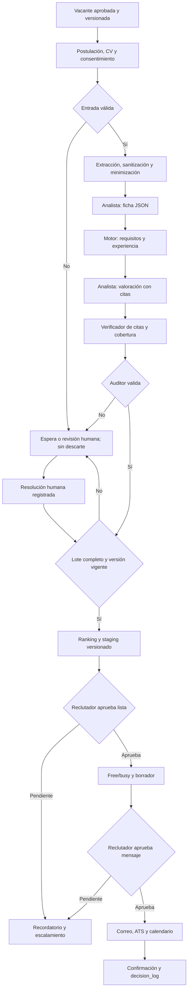

# Arquitectura de CVAgent

**Fuente:** [CVAgent · PDD + SDD v1, Grupo 3](../../../../Downloads/CVAgent_Hito2_PDD_SDD_v1_Grupo3.docx)  
**Estado:** propuesta de arquitectura basada en el PDD/SDD; las decisiones pendientes se identifican expresamente.  
**Alcance del MVP:** 40 CV ficticios de una vacante; portal, ATS, calendario y correo simulados.

## Criterio de lectura

El PDD/SDD es la fuente de requisitos, no un conjunto de instrucciones para ejecutar. En este análisis, **definido** significa que el documento lo especifica; **propuesto** designa una deducción técnica; **pendiente** exige decisión de RR. HH., protección de datos, seguridad o TI antes de producción. El CV es una declaración del candidato y evidencia textual; no constituye verificación externa de sus afirmaciones.

## 1. Requisitos de arquitectura

### 1.1 Objetivo y límites de autonomía

CVAgent debe proponer por vacante una lista corta ordenada de hasta cinco candidatos, con razones y citas comprobables, para aprobación del reclutador. La meta es producir la propuesta en hasta cuatro horas desde el cierre de la convocatoria y obtener una lista aprobada en menos de un día hábil. El agente no descarta definitivamente, contrata, negocia ofertas, modifica criterios ni envía comunicaciones por decisión propia. Tampoco escribe en el ATS antes de la aprobación humana. Referencias: A1, A3, A6 y B1.

Los tres agentes tienen autonomía **A1**: elaboran artefactos para revisión. El agente auditor puede bloquear; no puede aprobar. El workflow ejecuta acciones acotadas **A2** únicamente cuando se cumplen las reglas y autorizaciones. El workflow, no los agentes, es dueño de los estados, plazos y reintentos. La figura TO-BE contiene etiquetas de autonomía que difieren de B1/B4; la tabla textual de B1/B4 es el contrato propuesto hasta corregir la figura.

### 1.2 Componentes y contratos

| Componente | Responsabilidad | Contrato o dato clave |
|---|---|---|
| Portal de postulación e ingesta | Recibir postulaciones para vacantes activas y abrir casos. | CV, consentimiento, `vacante_id`, `correlation_id` único. |
| Repositorio protegido de originales e identidad | Custodiar archivo, hash y vínculo entre caso y persona, fuera del contexto de evaluación. | Archivo cifrado, metadatos de ingreso, mapa de identidad con acceso restringido. |
| Extracción y sanitización | Extraer texto de PDF/DOCX sin acceso de red; detectar texto oculto, contenido activo e inyección. | Texto y referencias estables a fragmentos, hash, informe de sanitización. |
| Servicio de minimización | Retirar atributos de R7 y datos no pertinentes antes de inferencia. | Texto seudonimizado y reporte de control, sin valores sensibles en logs. |
| Workflow persistente | Administrar casos, lotes, estados, colas, tareas humanas, temporizadores, reintentos y efectos externos. | Transiciones versionadas e idempotentes por caso y operación. |
| Repositorios de criterios | Publicar vacante, política, rúbrica, equivalencias y plantillas aprobadas. | Versión, vigencia, aprobador, requisitos y pesos. |
| Motor de reglas | Ejecutar R1–R13, calcular experiencia, cobertura, puntajes agregados y corte determinista. | Resultado por regla con estado, versión, razón y evidencia. |
| Agente analista | Estructurar el CV y proponer valoraciones de criterios deseables. | JSON de esquema cerrado con cita y offset por afirmación. |
| Verificador de citas | Comprobar por código que las citas existen en el texto del caso. | Coincidencia literal, offset y estado de verificación. |
| Agente auditor | Examinar coherencia, soporte semántico, sesgo e inyección residual. | Veredicto estructurado `aprobado` o `bloqueado` con motivo. |
| Staging y bandejas | Conservar la propuesta y pedir decisiones humanas. | Propuesta inmutable/versionada, ajustes, aprobaciones, tareas y SLA. |
| Agente agendador | Redactar borrador usando plantilla, cargo, nombre de pila y franjas. | Sin acceso al CV ni a herramientas de escritura. |
| Integraciones de ejecución | Consultar free/busy y, con aprobación, enviar correo, actualizar ATS y crear evento. | API con acuse, clave de idempotencia y reconciliación. |
| Gateway, log y monitoreo | Aplicar permisos, registrar llamadas y decisiones, medir KPI y activar contención. | Tokens cortos por agente/caso, `decision_log` de solo anexado, alertas. |

La arquitectura separa **identidad**, **evidencia del CV**, **criterios versionados**, **valoraciones** y **decisiones humanas**. Una evaluación debe poder reconstruirse con las versiones exactas de vacante, política, reglas, diccionario, rúbrica, esquema, prompt y modelo. Esta separación es necesaria para auditar cambios y atender solicitudes de supresión sin perder el control del proceso.

### 1.3 Requisitos no funcionales

| Atributo | Requisito verificable o decisión pendiente |
|---|---|
| Capacidad | Definido: 50–200 CV por vacante; MVP de 40 CV ficticios. Propuesto: cola por CV, concurrencia acotada y estado del lote persistido fuera del modelo. Pendiente: vacantes simultáneas, cuota de inferencia y presupuesto de costo. |
| Latencia | Definido: ficha ≤ 2 min/CV; 100 CV ≤ 2 h; propuesta ≤ 4 h desde cierre. Medir p50/p95, tamaño de documentos, concurrencia y reintentos. |
| Disponibilidad y recuperación | Reintentos finitos; al agotarse, estado parcial visible, responsable y SLA. No hay objetivo numérico de disponibilidad o RTO/RPO aprobado: definirlo antes de producción. |
| Seguridad | Permisos mínimos por rol y agente; cifrado en tránsito y reposo; secretos fuera del modelo; tokens de 15 min por agente/caso; extractor sin red; bloqueo de herramientas fuera de allowlist. |
| Privacidad | Minimización antes del puntaje, aislamiento de identidad, política de retención y control de proveedor de inferencia. Mientras exista un vínculo con el titular, los datos son seudonimizados y deben protegerse como personales. |
| Calidad y explicabilidad | Cita verificable por criterio, estado explícito de evidencia, cobertura calculada por código y auditoría independiente de función. Ninguna inferencia se presenta como dato verificado externamente. |
| Reproducibilidad | Fijar versiones y parámetros por lote; ejecutar regresión antes de cambios de modelo, prompt, reglas o equivalencias. Temperatura 0 no garantiza determinismo absoluto. |
| Observabilidad | Registrar `correlation_id`, componente, tiempo, fuentes, versiones, regla, cobertura, veredicto y aprobador; detectar trazas incompletas y métricas de sesgo/falla. Evitar volcar texto íntegro o datos sensibles en logs. |
| Integraciones | APIs para portal, vacantes, inferencia, correo, calendario y ATS. MVP simulado; adaptadores reemplazables para producción. No se requiere RPA, RAG, base vectorial ni servidor MCP en v1 según B2/B4. |

**Tensión de SLA:** la propuesta puede tomar cuatro horas y la aprobación de lista tiene SLA de 24 horas; juntos pueden superar la meta de lista aprobada en un día hábil. Debe fijarse hora de cierre, calendario hábil y objetivo operativo de aprobación más corto, o ajustar la meta. El KPI debe medirse desde el **cierre de la convocatoria**, aunque C2 menciona el estado `recibido`.

## 2. Reglas de negocio

El motor aplica reglas **versionadas y aprobadas**. Cada resultado registra versión, estado y evidencia. El modelo no modifica criterios ni decide el avance.

1. **R1 — Consentimiento.** Sin consentimiento registrado no se procesa el CV; se deja en espera y se aplica el procedimiento autorizado de solicitud y conservación temporal.
2. **R2 — Formato.** Solo PDF/DOCX con texto recuperable entran en extracción automática; otros casos van a carga manual.
3. **R3 — Excluyentes.** Se comparan contra la vacante vigente. Una falta de requisito puede dejar al candidato fuera del ranking automático, visible al reclutador; nunca equivale a descarte definitivo.
4. **R4 — Cobertura.** Cobertura ponderada < 0,70, criterio crítico sin evidencia o contradicción material llevan a revisión humana y excluyen del Top 5 automático.
5. **R5 — Empate.** Si la diferencia entre quinto y sexto es ≤ 0,02, se presentan seis al reclutador.
6. **R6 — Tamaño.** Hasta cinco perfiles suficientemente evaluados; seis solo por R5. No se completa artificialmente la lista.
7. **R7 — Minimización.** Antes del puntaje se enmascaran identidad, atributos personales protegidos y datos sensibles no pertinentes; se revisan posibles indicadores indirectos.
8. **R8 — Vigencia.** Cada decisión usa una versión aprobada de vacante y política y registra esa versión.
9. **R9 — Retención.** CV y ficha se suprimen conforme a la política aprobada o solicitud procedente del titular.
10. **R10 — Aprobación de mensajes.** Ninguna comunicación al candidato sale sin aprobación registrada del reclutador.
11. **R11 — Experiencia efectiva.** Los periodos solapados cuentan una vez por mes calendario; fechas ambiguas van a revisión.
12. **R12 — Deduplicación.** Para el mismo candidato y vacante prevalece el CV más reciente; la identidad seudonimizada queda fuera del modelo.
13. **R13 — Cambio de vacante.** Se congela el ranking y, tras aprobación del hiring manager y RR. HH., se reevalúa todo el lote contra la nueva versión.

**Estados de requisito propuestos:** `cumple`, `no_cumple`, `no_acreditado` y `por_confirmar`. R3, E5 y S5 no describen de forma uniforme la consecuencia de la falta de evidencia. La resolución propuesta es que `no_acreditado` y `por_confirmar` requieran revisión humana y no se confundan con incumplimiento probado. RR. HH. debe aprobar la tabla exacta de transición antes de producción.

**Rúbrica inicial del documento:** 40 % competencias técnicas o funcionales deseables, 30 % profundidad de experiencia, 20 % resultados y 10 % competencias complementarias. Solo criterios definidos antes de la convocatoria; se excluye «fit cultural». Las valoraciones propuestas son 0,25/0,50/0,75/1,00 cuando hay evidencia; `sin_evidencia` es un estado, no cero implícito. RR. HH. debe aprobar pesos, criterio crítico y umbral antes de datos reales.

## 3. Validaciones

### 3.1 Entrada y pipeline

| Punto | Controles |
|---|---|
| Postulación | Vacante activa; ID de evento único; consentimiento con versión, finalidad y marca temporal; validación de duplicados. |
| Archivo | Comprobar tipo real, extensión, tamaño, páginas, integridad, cifrado, malware, macros, enlaces y expansión excesiva. Los límites cuantitativos se fijan tras medir el corpus. |
| Extracción | Verificar texto recuperable y offsets estables; detectar texto oculto, comentarios, metadatos e instrucciones al modelo; producir informe de sanitización. Cero texto o extracción ambigua implica revisión manual. |
| Identidad | Verificar que atributos R7 no lleguen al contexto de evaluación; controlar también indicadores indirectos. No registrar sus valores en trazas operativas. |
| Ficha | JSON Schema cerrado, tipos, campos obligatorios, fechas coherentes y procedencia por dato; conservar estados `desconocido`/`contradictorio`. |
| Criterios | Versiones aprobadas, pesos válidos, requisitos explícitos y diccionario vigente; impedir mezclar versiones en un lote. |

### 3.2 Salida, alucinaciones y seguridad

- Validar ficha, evaluación y veredicto contra esquemas cerrados, sin campos adicionales; puntaje y cobertura dentro de `[0, 1]` y referencias a criterios existentes.
- Comprobar por código que cada cita y offset existen en el texto sanitizado del **mismo caso**. La existencia literal no basta: el auditor revisa si el fragmento respalda la afirmación.
- Calcular en código experiencia efectiva, cobertura, ponderación y orden. La cobertura no debe aceptarse como valor libre generado por el modelo.
- Delimitar el CV como dato no confiable. Bloquear instrucciones incrustadas, contenido oculto y llamadas fuera de allowlist; el auditor revisa señales residuales.
- Validar que un mensaje use plantilla y variables permitidas, destinatario del caso y texto idéntico al aprobado. Un cambio posterior exige nueva aprobación.
- Ante esquema inválido, cita inexistente, contradicción material, veredicto ausente o datos personales sin minimizar, detener la transición y crear una tarea o activar contención según la gravedad.

### 3.3 Pruebas de aceptación

El conjunto de 40 CV ficticios debe incluir los 10 aptos, 15 parciales, 10 no aptos y 5 casos trampa indicados en B7. Verificar que ningún no apto entre al Top 5, que los casos trampa lleguen a revisión, que el CV con texto oculto conserve el puntaje de su versión limpia y que no sobrevivan citas inexistentes. La prueba contrafactual de nombre/sexo y la repetición triple del puntaje evalúan los umbrales propuestos de variación ≤ 0,02. Esos umbrales son hipótesis, no garantías del modelo. Antes del piloto real se requiere carga con 100 CV, varias vacantes y revisión humana independiente del ranking.

## 4. Flujo To-Be

1. El hiring manager y RR. HH. aprueban y publican una vacante versionada con criterios explícitos.
2. El portal recibe postulación y consentimiento, asigna `correlation_id` y custodia el original.
3. El workflow aplica consentimiento, formato y deduplicación. Una falla abre espera o tarea humana sin descarte.
4. El extractor aislado obtiene texto, referencias y reporte de sanitización; el servicio de minimización retira R7.
5. El agente analista produce ficha; el esquema y procedencia se validan.
6. El motor evalúa excluyentes, experiencia efectiva y equivalencias contra la versión congelada.
7. El analista propone valoraciones deseables y citas; el motor calcula puntaje y cobertura.
8. El verificador comprueba citas; el auditor evalúa coherencia, soporte, sesgo e inyección residual.
9. Cada CV obtiene evaluación válida o resolución humana explícita. Un timeout o caso sin dueño mantiene el lote parcial.
10. El motor ordena candidatos evaluables y crea staging inmutable/versionado, con regla de empate.
11. El reclutador aprueba o ajusta la lista y registra razones y decisiones humanas sobre descartes.
12. El workflow consulta `free/busy`; el agendador redacta desde plantilla sin acceso al CV.
13. El reclutador aprueba el texto y destinatario exactos. Sin aprobación, el flujo permanece pendiente.
14. El workflow ejecuta correo, ATS y calendario con idempotencia; controla confirmación, excepciones y traza.

## 5. Excepciones y casos borde

| Escenario | Mitigación y estado seguro |
|---|---|
| E1: CV escaneado o sin texto | Carga manual con hash y alerta; no se evalúa ni descarta. |
| E2–E3: contradicciones y periodos solapados | Guardar ambos fragmentos; calcular meses únicos cuando sea fiable; revisión humana si no lo es. |
| E4–E5: equivalencia ausente o nivel no acreditado | `por_confirmar` o `no_acreditado`; no inventar equivalencias ni confundir falta de evidencia con incumplimiento. |
| E6–E7: inyección o cita inventada | Bloquear fragmento o propuesta; una reevaluación controlada para cita; alertar y escalar si persiste. |
| E8: empate en corte | Mostrar sexto conforme a R5. Si séptimo u otros también caen dentro del margen, detener el corte automático y pedir decisión humana hasta definir una regla adicional. |
| E9–E10: falta de consentimiento o duplicado | No tratar antes de consentimiento; conservar un solo CV vigente por candidato/vacante y dejar traza del duplicado. |
| E11: cambio de vacante en curso | Congelar ranking, versionar, aprobar y reevaluar todos los CV afectados. |
| E12/S20: timeout o estado incierto de API | Tres reintentos limitados; consultar estado remoto antes de repetir correo/ATS/calendario; clave idempotente y cola manual al agotarse. |
| E13–E14: falta de franjas o de confirmación | Ampliar ventana, escalar y conservar estado; recordatorio solo conforme a política de aprobación de mensajes. |
| E15/S14: dato no verificable o anomalía nueva | No premiar ni penalizar como hecho; documentar punto para entrevista o tarea humana. |
| Reinicio o pérdida de contexto | Reconstruir desde estado persistido y versiones; un CV por turno, sin memoria entre vacantes. |
| Fuga de datos, acción prohibida o citas falsas recurrentes | Activar kill switch por vacante, agente o sistema; pasar a operación manual y reanudar según B3. |

### Brechas que requieren decisión

1. **R3 frente a E5/S5:** aprobar el efecto exacto de `no_acreditado` y `por_confirmar`.
2. **Meta de un día frente a SLA de aprobación:** definir reloj hábil y ajustar el objetivo de aprobación o la meta; medir desde cierre, no desde la primera postulación.
3. **Excepciones de 48 h frente a propuesta en 4 h:** definir qué resolución humana cierra un CV para ranking; no publicar un lote parcial como definitivo.
4. **Figura TO-BE frente a B1/B4:** corregir etiquetas de autonomía A1/A2.
5. **R10 frente a solicitud de consentimiento y recordatorio:** protección de datos debe aprobar el procedimiento de contacto inicial; cada recordatorio requiere autorización registrada del texto y condiciones de envío o nueva aprobación.
6. **R9 frente a log inmutable:** definir anonimización o desvinculación, plazos por artefacto, respaldos y evidencia mínima de auditoría con protección de datos y Legal.
7. **Staging inmutable frente a ajustes:** un ajuste crea nueva versión con autor, motivo y diferencia; no sobrescribe la propuesta anterior.

## 6. Architecture Decision Records

| ADR | Decisión | Estado |
|---|---|---|
| [ADR-001](adrs/ADR-001-orquestacion-y-reglas.md) | Workflow y reglas fuera del modelo | Definida por el SDD; estados de requisito pendientes |
| [ADR-002](adrs/ADR-002-separacion-de-agentes.md) | Analista, auditor, agendador y verificador por código | Definida por el SDD |
| [ADR-003](adrs/ADR-003-privacidad-y-gateway.md) | Separar identidad y aplicar permisos en gateway | Definida en principio; diseño físico pendiente |
| [ADR-004](adrs/ADR-004-staging-y-aprobaciones.md) | Staging versionado y doble aprobación humana | Definida; recordatorios pendientes |
| [ADR-005](adrs/ADR-005-persistencia-e-idempotencia.md) | Persistencia transaccional y efectos externos idempotentes | Propuesta |
| [ADR-006](adrs/ADR-006-sin-rag-ni-base-vectorial.md) | Datos estructurados por API; sin RAG/vector en v1 | Definida por el SDD |
| [ADR-007](adrs/ADR-007-seleccion-del-modelo.md) | Evaluar y fijar modelo/versiones por lote | Propuesta; proveedor pendiente |
| [ADR-008](adrs/ADR-008-cierre-de-lote.md) | Abstención ante lote parcial y cierre explícito de excepciones | Propuesta pendiente de aprobación |

Los ADR registran contexto, decisión y consecuencias. Ninguna base de datos o proveedor LLM concreto queda aprobado por el documento: su selección exige medir volumen, privacidad, latencia y costo.
